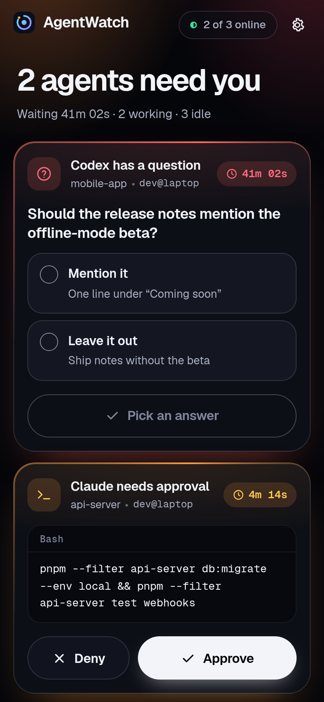
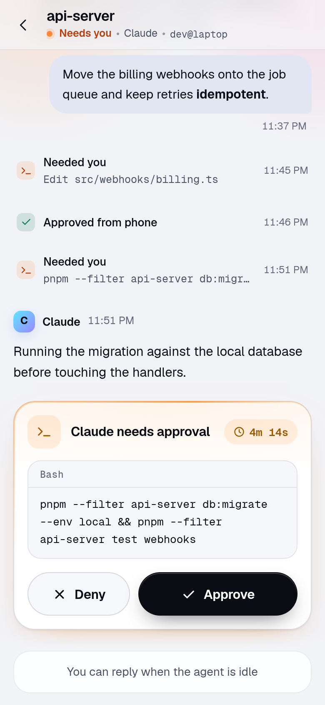
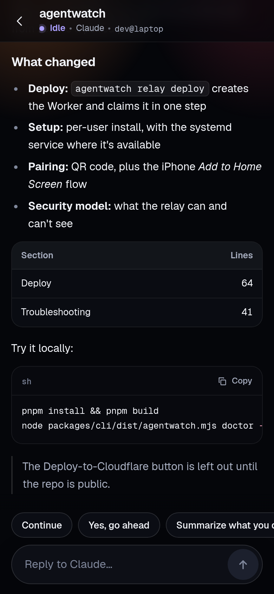

# AgentWatch

**A pager for your coding agents.** Your phone buzzes when a Claude Code or Codex session needs you or finishes a long
task. One list shows every session across your computers and OS users. You can answer from the phone: approve or deny
a command, pick an answer to the agent's question, or send a short follow-up.

It runs on your own free Cloudflare account and is end-to-end encrypted, so Cloudflare only ever relays ciphertext.
There's no app store app, no third-party push service and no subscription.

<p>
  
  
  
</p>

## How it works

```
Claude Code ─ plugin hooks + mod ─┐
Codex ─ its app-server (JSON-RPC) ┼─▶ agentwatch daemon ══ one outbound WebSocket ══▶ your relay ── Web Push ──▶ phone
your scripts ─ agentwatch ask ────┘   (one per OS user)                              (Worker + Durable Object)   (PWA)
```

- **Nothing in the agent's way.** Hooks fail open. If AgentWatch is down, they exit instantly and the agent behaves
  exactly as it would without it. The terminal dialog stays live while the phone holds the same request, and the first
  answer wins.
- **Adapters, not wrappers.** You keep starting agents the way you do now. Claude Code is watched through a plugin;
  Codex through the app-server it already runs.
- **Your relay, your key.** Prompts, commands and replies are sealed with a key that lives only on your computers and
  paired phones. Phone commands are sealed and checked too, so the relay can't forge an approval. See
  [SECURITY.md](SECURITY.md).
- **Built for a glance.** Whatever needs you sits on a rail at the top, its timer aging. Everything else stays quiet,
  including at 3 a.m. in the dark.

## Set it up (about 15 minutes)

You need Node 22.12+ (24 recommended), pnpm, a free [Cloudflare](https://dash.cloudflare.com/sign-up) account and Linux
or macOS. macOS works in principle but hasn't been tested yet.

```sh
git clone https://github.com/<you>/agentwatch && cd agentwatch
corepack enable && pnpm install && pnpm build
npx wrangler login                                  # opens your browser once
node packages/cli/dist/agentwatch.mjs relay deploy  # deploys your relay and connects this OS user
```

`relay deploy`:

1. Deploys the Worker, its Durable Object and the phone app to your account.
2. Gives the relay a fresh claim secret and claims it, so it only ever accepts you.
3. Installs AgentWatch for this OS user: the `agentwatch` command, a fail-open hook launcher, and the Claude Code
   plugin.

Run it again any time to upgrade.

Then pair your phone:

```sh
agentwatch pair          # shows a QR code and a one-time link (valid 10 minutes)
```

- **Android (Chrome):** scan, tap **Pair**, then **Turn on notifications** and **Send a test notification**. Install
  the app from Chrome's menu.
- **iPhone (iOS 16.4+):** scan, then in Safari tap Share → **Add to Home Screen**. Open AgentWatch from the Home Screen
  and paste the code. iOS only delivers push to Home Screen apps, and they keep their own storage.

Check every link from this computer to the phone:

```sh
agentwatch doctor --test-push
```

Finally, **restart your Claude Code sessions** so they load the plugin. Codex needs nothing installed: AgentWatch
attaches to the app-server that Codex's TUI already uses.

You never start AgentWatch by hand. Where the user has a systemd user session (a desktop login, or a user with
lingering on), setup installs `agentwatch.service`, which starts the daemon at login, or at boot for a lingering user.
Elsewhere, the first Claude Code hook or `agentwatch` command starts it. On a computer without the service where you
only run Codex, run any `agentwatch` command (say, `agentwatch status`) once after a reboot.

### More OS users or computers

Each OS user runs its own daemon, so one user's agents can't be steered from another account. The OS user that ran
`relay deploy` is the **owner**: phones are paired, and other users and computers invited, from there.

```sh
agentwatch invite        # as the owner: prints a one-time invite
agentwatch join          # on the other computer or OS user: paste the invite, then confirm
```

`invite` prints the exact command for another OS user on the same machine. You run that one yourself, with sudo.
`join` says what the relay's owner will be able to do with that user's agents, and asks before it joins. If that user
has no Node 22+ of their own, `join` gives it a private copy, rather than running yours on every hook.

Options for `relay deploy`, `setup` and `join`:

| Option | Effect |
| --- | --- |
| `--privacy summary` | No text (prompts, commands, messages) ever leaves this user. The phone still sees states, project names and pushes. Good for a work account. |
| `--no-messages` | Approvals and answers still work, but free-text replies from the phone are refused. |
| `--no-claude` | Don't install the Claude Code plugin. |
| `--no-service` | Don't install the systemd user service; the daemon then starts with the first Claude hook. |

Already deployed the relay another way? Connect with `agentwatch setup --relay https://agentwatch.<you>.workers.dev`
and paste the relay's claim secret when asked (or set `AGENTWATCH_CLAIM_SECRET`). The secret is the relay's
`CLAIM_SECRET`: set it with `npx wrangler secret put CLAIM_SECRET` in `packages/relay`.

Lost the owner computer? Set a new claim secret that way, then run `agentwatch setup --force --relay <url>` on the new
owner and paste it. That signs out every other computer and phone; pair and invite them again.

## Everyday use

| Command | What it does |
| --- | --- |
| `agentwatch status` | What the daemon sees right now |
| `agentwatch mute 1h` / `mute until 08:00` / `mute off` | Pause notifications on every phone; the app still shows everything |
| `agentwatch doctor [--test-push]` | Explain what's broken, link by link |
| `agentwatch rotate` | New end-to-end key, for a lost phone or a leaked invite. Signs out every phone and other computer, then pairs again. |
| `agentwatch uninstall [--purge]` | Remove AgentWatch for this user (`--purge` also removes the config and key) |

What buzzes:

| Push | When |
| --- | --- |
| **Needs you** | An agent asks for permission or asks a question, and it isn't answered at the keyboard within 10 s. High priority. Android shows Approve and Deny on the notification. |
| **Finished** | A turn that took 30 s or more ends |
| **Offline** | A computer has been gone for 10 minutes while one of its agents was working or waiting on you (once per outage) |

## Your own scripts and agents

Any script can ask the human:

```sh
env=$(agentwatch ask "Deploy which build?" --choices staging,production --timeout 15m) || exit
agentwatch ask --approve "Run the migration on prod?" && ./migrate.sh
agentwatch emit --session nightly-etl --state working --message "Step 2 of 4" --pid $$
```

See [docs/writing-an-adapter.md](docs/writing-an-adapter.md) for the flags, exit codes, the local socket API, and how to
write a built-in adapter.

## Limits worth knowing

- **Codex embedded sessions:** sessions started with `-c`, `--enable`, `--disable` or `--search` run Codex in embedded
  mode, without the shared app-server, so AgentWatch can't see them.
- **Replies need the plugin:** replies into Claude Code need the session to have the plugin loaded. Restart sessions
  that started before setup.
- **One owner:** a relay belongs to one owner. Developers on your team each deploy their own; there's no team relay
  in v1.
- **Not in v1:** transcripts, starting sessions from the phone, and Windows.
- **Cost:** a person's traffic sits far below the free plan's limits (100k Worker and Durable Object requests a day).
  The Durable Object hibernates when idle.

## Develop

```sh
pnpm install
pnpm build          # the phone app and the CLI bundle
pnpm test           # unit tests, plus an E2E harness: real hooks → daemon → relay (workerd) → fake phone
pnpm typecheck && pnpm lint
pnpm dev:relay      # a local relay with the app at http://localhost:8787 (try /?demo)
```

The app has demo fixtures for every state (`?demo`, `?demo=calm`, `?demo=new`, `?demo=offline`). Regenerate the
screenshots with `pnpm --filter @agentwatch/app screenshots`. Read [CONTRIBUTING.md](CONTRIBUTING.md),
[docs/architecture.md](docs/architecture.md) and [docs/protocol.md](docs/protocol.md).

## License

[MIT](LICENSE)
